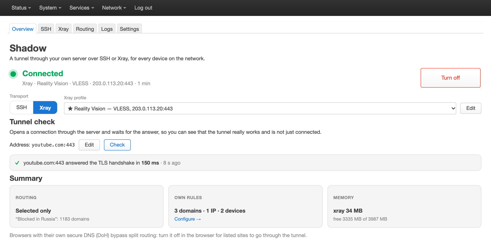
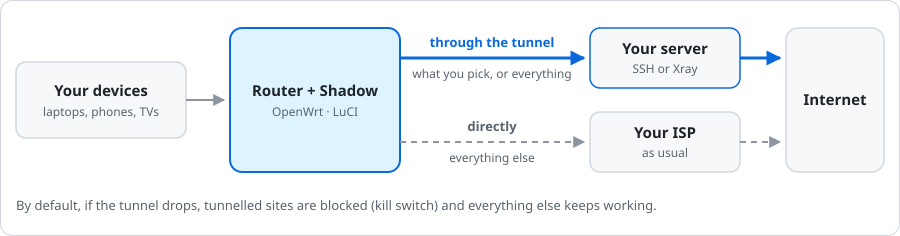
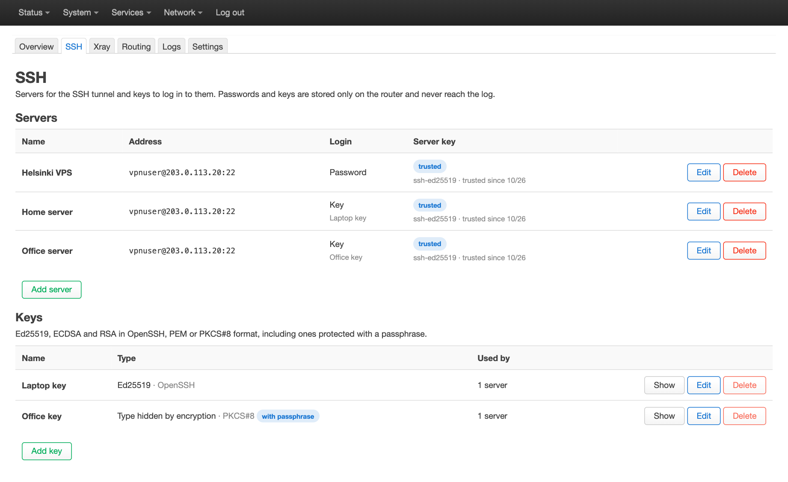
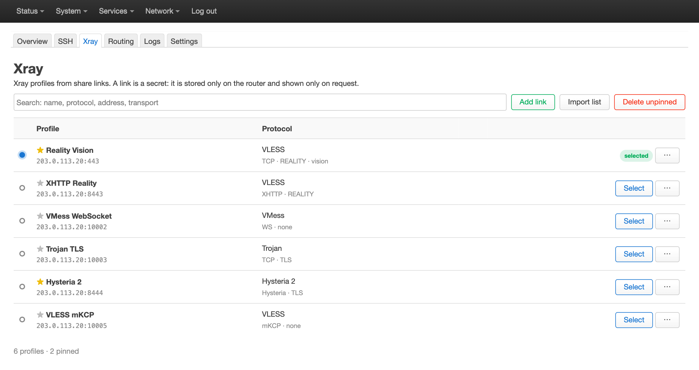
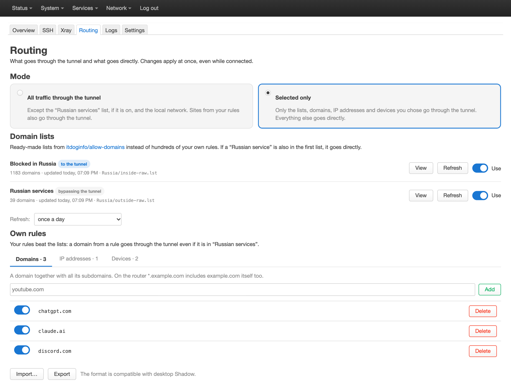
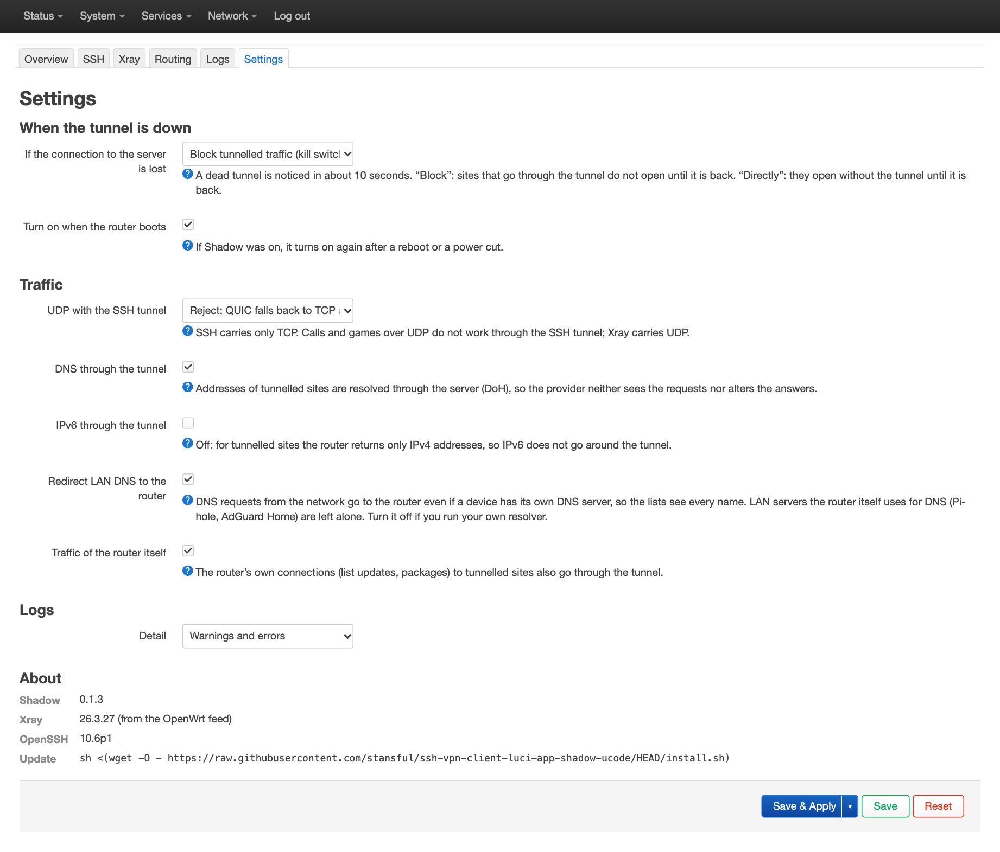
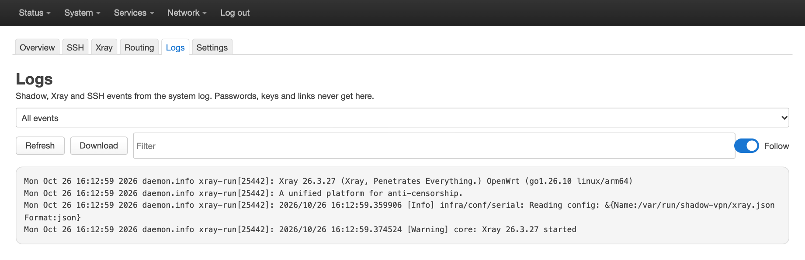

# Shadow for OpenWrt

> [!IMPORTANT]
> **Disclaimer.** This app is a test of whether today's neural networks can build applications with minimal
> developer involvement. The answer is **yes**.

[Русский](README.md) · **English**

Shadow sends the traffic of your whole home network through your own server, over SSH or through Xray (VLESS,
VMess, Trojan, Hysteria 2). It is the router edition of the
[Shadow desktop app](https://github.com/stansful/ssh-vpn-client-electron): it installs on OpenWrt with one command
and lives in LuCI under **Services → Shadow**. The pages are in English and Russian.



## How it works



Either all of the network's traffic goes through the tunnel (Russian services can stay direct if you like), or
only what you pick: sites, IP addresses and devices. Everything else goes directly, as it would without Shadow.
The tunnel is an SSH connection to your server (nothing to install on it) or an Xray profile from a share link.

## Install

You need a router with **OpenWrt 25.12 or newer**, about 45 MB of free flash and 50 MB of free memory.

> [!WARNING]
> Before you install, turn off or remove other routing tools: Podkop, Forkop, passwall, passwall2 and the like.
> They change the same DNS settings and nftables rules and would get in Shadow's way.

SSH into the router and run:

```sh
sh <(wget -O - https://raw.githubusercontent.com/stansful/ssh-vpn-client-luci-app-shadow-ucode/HEAD/install.sh)
```

The rest happens in LuCI, under Services → Shadow:

1. Add a server on the SSH tab, or a link on the Xray tab.
2. Pick a mode on the Routing tab.
3. On the Overview tab, pick SSH or Xray under Transport and press Turn on.

<details>
<summary>What the installer does, and which routers work</summary>

- It checks the router, downloads the packages from the
  [latest release](https://github.com/stansful/ssh-vpn-client-luci-app-shadow-ucode/releases/latest), verifies
  their checksums and installs them. Shadow is off after a fresh install.
- It replaces `dnsmasq` with `dnsmasq-full` (your `/etc/config/dhcp` stays as it is) and sets the router clock
  over NTP when it is off: HTTPS does not work without the right time.
- It adds the Russian translation when LuCI is in Russian, and asks otherwise.
- It refuses OpenWrt 24.10 and older: their xray-core is too old.
- The reference router is the Cudy TR3000 256MB v1 on OpenWrt 25.12.6. Shadow's packages are
  architecture-independent, and xray-core, OpenSSH and dnsmasq-full come from the official OpenWrt feed, so any
  router the feed builds them for works.

</details>

## Features

### SSH tunnel

Any server you can SSH into works, with a password or a key (Ed25519, ECDSA, RSA, passphrase-protected ones
too). The server's host key is remembered on the first connection, and you can pin its fingerprint.



### Xray profiles from links

Paste a `vless://`, `vmess://`, `trojan://` or `hysteria2://` link, or many at once, one per line. Star the
profiles you keep and delete the rest with one button.



### Everything, or only what you pick

- **Ready-made site lists** from [itdoginfo/allow-domains](https://github.com/itdoginfo/allow-domains) turn on
  with one switch and refresh on their own. "Blocked in Russia" sends blocked sites to the tunnel, so you need no
  rules of your own for them. "Russian services" keeps Russian sites direct, even when everything else goes
  through the tunnel.
- **Your own rules:** domains, IP addresses and subnets, devices by MAC or IP. They apply at once, even while
  connected. Import and export use the desktop app's format.



### Reliable and private

- **Kill switch by default.** When the tunnel is down, the sites that should go through it do not open
  directly, and everything else keeps working. Settings can let them go direct instead.
- **Reconnects on its own.** A dead tunnel is noticed in about 10 seconds, and Shadow brings it back when the
  server or the WAN returns. After a reboot Shadow turns on again if it was on.
- **DNS through the tunnel.** Names of tunnelled sites are resolved through the server (DoH), so your ISP does
  not see them. The router catches the LAN's DNS queries, so domain rules work for every device.
- **Keeps secrets safe.** Passwords, keys and links stay on the router, in `/etc/shadow-vpn` with mode `0600`.
  They never reach the log, and LuCI shows a key or a link only when you ask for it.
- **Easy on the router.** No resident process of its own, and direct traffic stays in the kernel, hardware
  offload included.



### Log

Shadow, Xray and SSH events in one place: filter by level or text, download, clear, follow. For debugging, set
Settings → Logs → Detail to Debug, and back to Warnings and errors when you are done.

A line `app/observatory/burst: error ping … with proxy` is one tunnel probe that got no answer in time; one alone
changes nothing, as Shadow treats the tunnel as down only after two failed probes in a row. Several within a few
minutes, often with `app/dns: failed to retrieve response`, mean the connection to the server stalled for a while:
the network on the way, the server, or a fully loaded router.



## Update

Shadow updates right from LuCI: Services → Shadow → Settings → Updates shows the installed and the latest
version, with the "Check now" and "Update to …" buttons. If Shadow was on, it stays on.

Choose how it updates in the same place:

- **"Check daily and show a notice"** (the default). Once a day the router asks GitHub which release is the
  latest, and when there is a new version, the Overview shows a notice.
- **"Install automatically at night".** A new version installs itself between 03:00 and 06:00 router time. The
  files come only from the project's releases on GitHub and are checked against their checksums. The tunnel
  restarts for a few seconds; if it does not come back after the update, Shadow puts the previous version back.
- **"Only when I check".** The router asks GitHub only when you press "Check now".

The install command still updates Shadow too, including versions without the Updates section. LuCI shows it as
well: Services → Shadow → Settings → About. While an update from LuCI or at night is running, the command says so
and stops: run it again in a few minutes.

<details>
<summary>If the command ends with a wget error</summary>

This happens when Shadow is on in "All traffic through the tunnel" mode with the kill switch and its tunnel is
down: the router cannot download anything, not even the installer. Turn Shadow off (Services → Shadow →
Turn off), run the command and turn Shadow back on. If the tunnel goes down while the installer runs, it stops
and tells you the same.

</details>

## Uninstall

```sh
sh <(wget -O - https://raw.githubusercontent.com/stansful/ssh-vpn-client-luci-app-shadow-ucode/HEAD/install.sh) --uninstall
```

Shadow turns off and its packages are removed. `dnsmasq-full` stays, so DNS and DHCP keep working. The settings
stay in `/etc/config/shadow-vpn` and `/etc/shadow-vpn`: delete them if you no longer need them.

## More

- [docs/DEVELOPMENT.md](docs/DEVELOPMENT.md): how it works inside, builds, tests, releases.
- [docs/DESIGN.md](docs/DESIGN.md): the design and its [known limits](docs/DESIGN.md#13-known-limits), such as
  a browser's own secure DNS (DoH) bypassing "Selected only" mode.
- [Shadow for your computer](https://github.com/stansful/ssh-vpn-client-electron): Windows, macOS, Linux.
