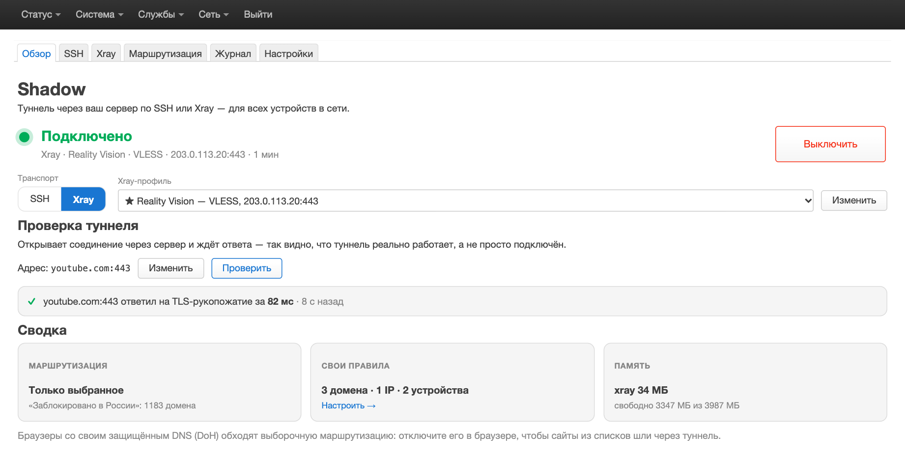
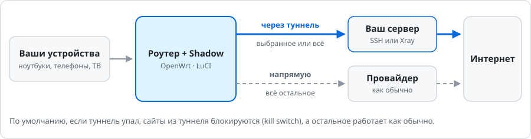
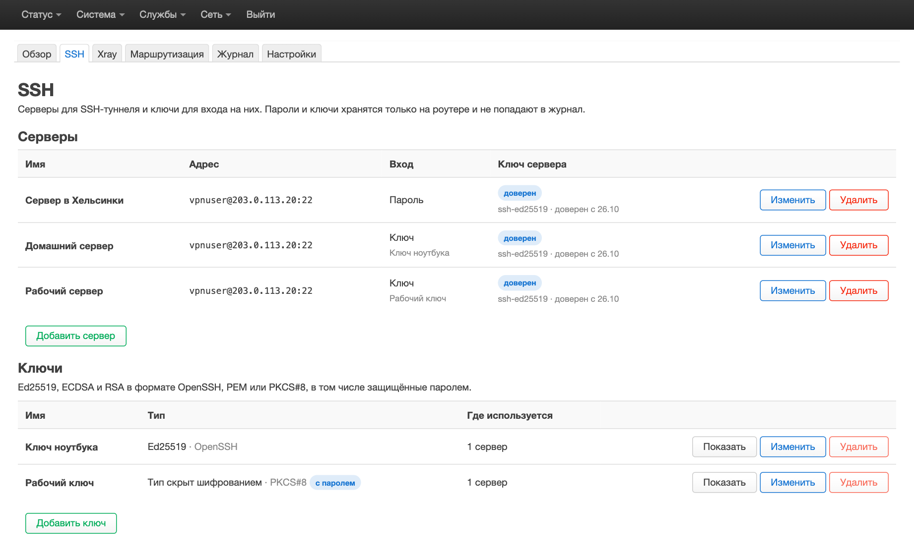
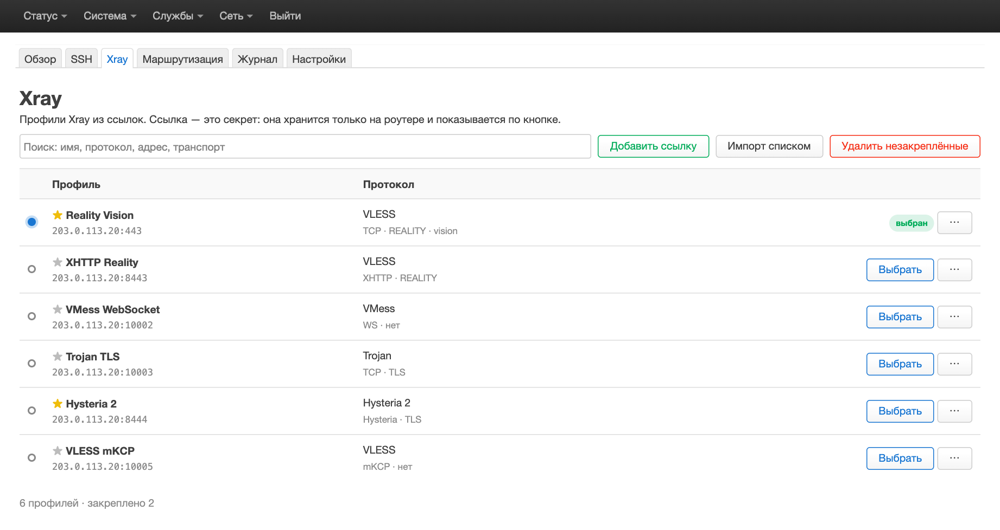
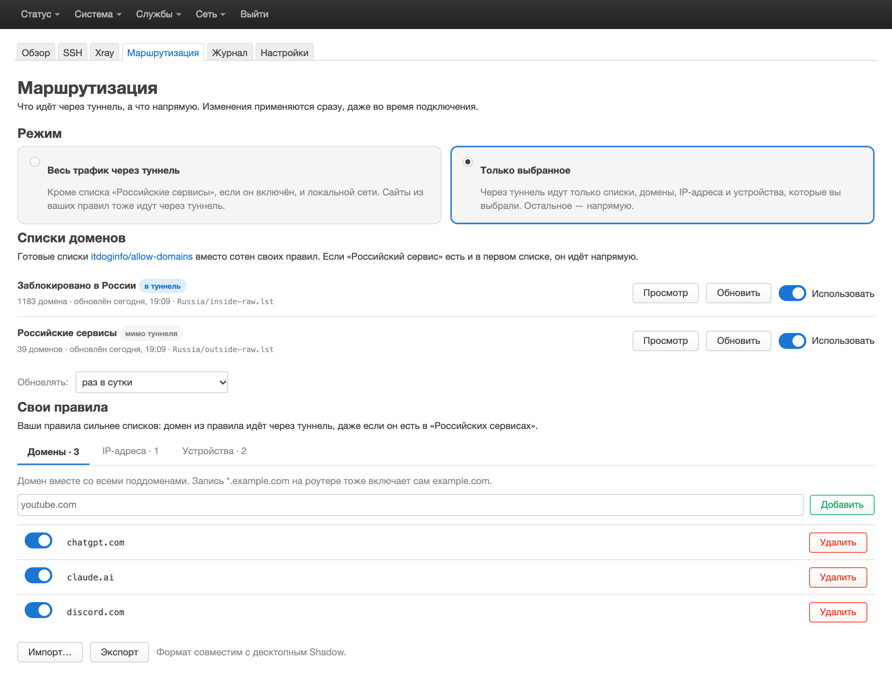
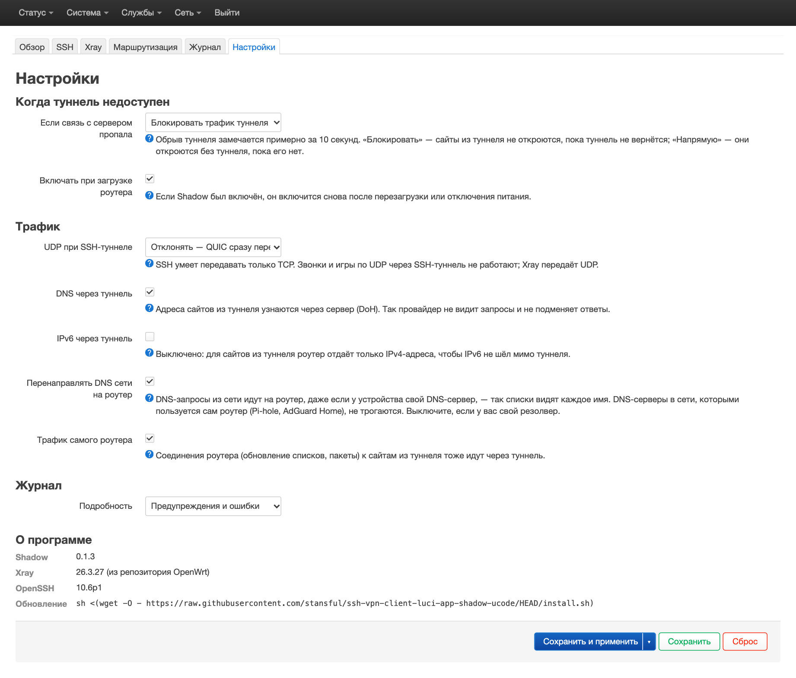
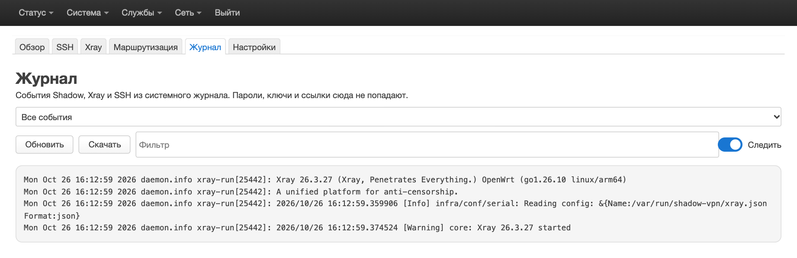

# Shadow для OpenWrt

> [!IMPORTANT]
> **Дисклеймер.** Это приложение — проверка того, могут ли современные нейросети создавать приложения
> с минимальным участием разработчика. Ответ — **да**.

**Русский** · [English](README.en.md)

Shadow пускает трафик всей домашней сети через ваш собственный сервер: по SSH или через Xray (VLESS, VMess,
Trojan, Hysteria 2). Это роутерная версия десктопного [Shadow](https://github.com/stansful/ssh-vpn-client-electron):
ставится на OpenWrt одной командой и настраивается в LuCI, в разделе «Службы → Shadow». Интерфейс — на русском
и английском.



## Как это работает



Через туннель идёт либо весь трафик сети (по желанию — кроме российских сервисов), либо только то, что вы
выбрали: сайты, IP-адреса и устройства. Остальное идёт напрямую, как без Shadow. Туннель — это SSH-подключение
к вашему серверу (ставить на него ничего не нужно) или Xray-профиль из ссылки.

## Установка

Нужен роутер с **OpenWrt 25.12 или новее**, около 45 МБ свободного места и 50 МБ свободной памяти.

> [!WARNING]
> Перед установкой выключите или удалите другие инструменты маршрутизации: Podkop, Forkop, passwall,
> passwall2 и подобные. Они меняют те же настройки DNS и правила nftables и будут мешать Shadow.

Зайдите на роутер по SSH и выполните:

```sh
sh <(wget -O - https://raw.githubusercontent.com/stansful/ssh-vpn-client-luci-app-shadow-ucode/HEAD/install.sh)
```

Дальше всё в LuCI, «Службы → Shadow»:

1. Добавьте сервер на вкладке «SSH» или ссылку на вкладке «Xray».
2. Выберите режим на вкладке «Маршрутизация».
3. На вкладке «Обзор» выберите транспорт — SSH или Xray — и нажмите «Включить».

<details>
<summary>Что делает установщик и на каких роутерах работает</summary>

- Проверяет роутер, скачивает пакеты из
  [последнего релиза](https://github.com/stansful/ssh-vpn-client-luci-app-shadow-ucode/releases/latest),
  сверяет контрольные суммы и устанавливает их. После установки Shadow выключен.
- Заменяет `dnsmasq` на `dnsmasq-full` (настройки в `/etc/config/dhcp` остаются) и при необходимости
  выставляет часы роутера по NTP: без правильного времени HTTPS не работает.
- Ставит русский перевод, если LuCI на русском, иначе спрашивает.
- На OpenWrt 24.10 и старше откажет: там слишком старый xray-core.
- Эталонный роутер — Cudy TR3000 256MB v1 на OpenWrt 25.12.6. Пакеты Shadow не зависят от архитектуры,
  а xray-core, OpenSSH и dnsmasq-full ставятся из официального репозитория OpenWrt, так что подойдёт любой
  роутер, для которого они собраны.

</details>

## Что умеет

### Подключение по SSH

Подойдёт любой сервер, куда вы заходите по SSH, по паролю или по ключу (Ed25519, ECDSA, RSA, в том числе
с паролем). Ключ сервера запоминается при первом подключении, отпечаток можно закрепить.



### Xray-профили из ссылок

Вставьте ссылку `vless://`, `vmess://`, `trojan://` или `hysteria2://`, одну или сразу много, по одной на
строку. Нужные профили можно закрепить звёздочкой, а остальные удалить одной кнопкой.



### Весь трафик или только выбранное

- **Готовые списки сайтов** из [itdoginfo/allow-domains](https://github.com/itdoginfo/allow-domains)
  включаются одним переключателем и обновляются сами. «Заблокировано в России» отправляет в туннель заблокированные
  сайты, и заводить на них свои правила не нужно. «Российские сервисы» оставляет российские сайты напрямую,
  даже когда через туннель идёт всё.
- **Свои правила:** домены, IP-адреса и подсети, устройства по MAC или IP. Применяются сразу, даже во время
  подключения. Импорт и экспорт совместимы с десктопным Shadow.



### Надёжность и приватность

- **Kill switch по умолчанию.** Если туннель упал, сайты из туннеля не открываются напрямую, а всё остальное
  работает. В «Настройках» можно выбрать и «Пустить трафик напрямую».
- **Переподключается сам.** Обрыв замечается примерно за 10 секунд, после возврата сервера или смены WAN
  туннель поднимается снова. После перезагрузки Shadow включается, если был включён.
- **DNS через туннель.** Адреса сайтов из туннеля разрешаются через сервер (DoH), провайдер их не видит.
  DNS-запросы устройств сети перехватываются роутером, так что правила по доменам работают для всех.
- **Секреты в безопасности.** Пароли, ключи и ссылки хранятся только на роутере, в `/etc/shadow-vpn` с правами
  `0600`. В журнал они не попадают, а ключ или ссылку LuCI показывает только по вашему запросу.
- **Бережёт роутер.** Своего постоянного процесса нет, прямой трафик остаётся в ядре вместе с аппаратным
  ускорением.



### Журнал

События Shadow, Xray и SSH в одном месте: фильтр по уровню и тексту, скачивание, очистка, автопрокрутка. Для
отладки выберите в «Настройки → Журнал → Подробность» уровень «Отладка», а по окончании верните «Предупреждения и
ошибки».

Строка `app/observatory/burst: error ping … with proxy` — одна проверка туннеля, не получившая ответа вовремя; одна
такая ничего не меняет: Shadow считает туннель упавшим только после двух неудачных проверок подряд. Несколько за пару
минут, часто вместе с `app/dns: failed to retrieve response`, значат, что связь с сервером ненадолго замирала: сеть по
пути, сервер или перегруженный роутер.



## Обновление

Shadow обновляется прямо из LuCI: «Службы → Shadow → Настройки → Обновления». Там видно, какая версия установлена
и какая вышла последней, и есть кнопки «Проверить сейчас» и «Обновить до …». Если Shadow был включён, он
останется включённым.

Там же выбирается, как обновляться:

- **«Проверять ежедневно и показывать уведомление»** (по умолчанию). Раз в день роутер спрашивает у GitHub, какой
  релиз последний, и если вышла новая версия, на «Обзоре» появляется уведомление.
- **«Устанавливать автоматически ночью».** Новая версия ставится сама между 03:00 и 06:00 по часам роутера. Файлы
  скачиваются только из релизов проекта на GitHub и сверяются с контрольными суммами. Туннель перезапускается на
  несколько секунд; если после обновления он не поднялся, Shadow вернёт предыдущую версию.
- **«Только когда я проверю».** Роутер обращается к GitHub, только когда вы нажмёте «Проверить сейчас».

Команда установки, как и раньше, тоже обновляет Shadow, в том числе версии без раздела «Обновления». Она есть
и в LuCI: «Службы → Shadow → Настройки → О программе». Если в этот момент идёт обновление из LuCI или ночное,
команда сообщит об этом и остановится: запустите её снова через несколько минут.

<details>
<summary>Если команда закончилась ошибкой wget</summary>

Так бывает, когда Shadow включён в режиме «Весь трафик через туннель» с kill switch, а туннель сейчас не
работает: роутер не может ничего скачать, даже установщик. Выключите Shadow («Службы → Shadow →
Выключить»), выполните команду и включите Shadow снова. Если туннель упадёт уже во время установки,
установщик остановится и подскажет то же самое.

</details>

## Удаление

```sh
sh <(wget -O - https://raw.githubusercontent.com/stansful/ssh-vpn-client-luci-app-shadow-ucode/HEAD/install.sh) --uninstall
```

Shadow выключится, его пакеты удалятся. `dnsmasq-full` останется, DNS и DHCP продолжат работать. Настройки
остаются в `/etc/config/shadow-vpn` и `/etc/shadow-vpn`: удалите их, если они больше не нужны.

## Подробнее

- [docs/DEVELOPMENT.md](docs/DEVELOPMENT.md) — как это устроено, сборка, тесты, релизы (на английском).
- [docs/DESIGN.md](docs/DESIGN.md) — архитектура и [известные ограничения](docs/DESIGN.md#13-known-limits),
  тоже на английском. Например, защищённый DNS (DoH) в браузере обходит режим «Только выбранное».
- [Shadow для компьютера](https://github.com/stansful/ssh-vpn-client-electron) — Windows, macOS, Linux.
